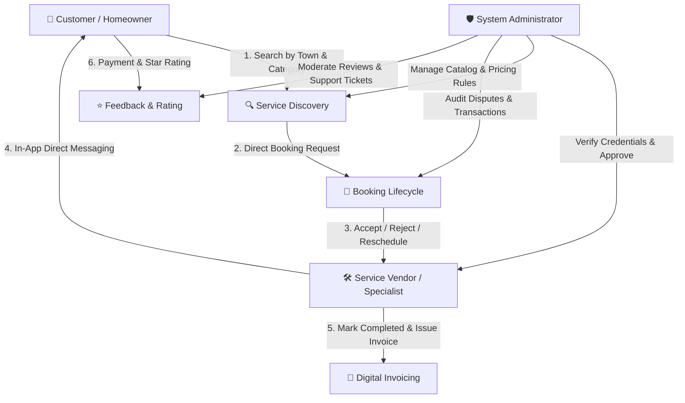

# FixNow — On-Demand Home & Technical Service Marketplace

<div align="center">


[](https://www.php.net/)
[](https://www.mysql.com/)
[](https://vercel.com/)
[](https://tidbcloud.com/)
[](LICENSE)

**A full-stack web marketplace designed to bridge the gap between homeowners and verified, skilled service technicians across Sri Lanka.**

[Project Duties & Objectives](#-project-duties--business-objectives) • [System Actors & Responsibilities](#-system-actors--responsibilities) • [Project Structure & File Duties](#-project-structure--file-duty-mapping) • [Database Architecture](#-database-architecture) • [Setup & Deployment](#-setup--installation-guide)

---

</div>

## 🎯 Project Duties & Business Objectives

### 1. Problem Statement
In Sri Lanka, finding reliable, certified, and punctual domestic repair technicians (electricians, plumbers, AC technicians, carpenters, painters, and cleaners) has traditionally been disorganized. Homeowners face:
* **Uncertain technician credibility** and lack of verified credentials.
* **Non-transparent pricing**, arbitrary labor quotes, and hidden charges.
* **Manual scheduling friction**, missed appointments, and zero accountability.
* **No formal dispute mechanism**, lack of customer reviews, and no invoice records.

### 2. Core Project Duty
The primary duty of **FixNow** is to provide an end-to-end, trustworthy digital platform that standardizes the on-demand service ecosystem:
1. **Verification & Quality Control**: Ensure only vetted specialists with verified profiles offer services.
2. **Transparent Discovery**: Enable customers to filter specialists by district, town, and service discipline with visible base rates.
3. **Automated Booking Workflow**: Manage the complete lifecycle from request creation, specialist acceptance, real-time messaging, to job completion.
4. **Billing & Financial Accountability**: Provide formal digital invoicing and support multiple payment options (Cash on Delivery, Direct Card, and PayHere online payment gateway).
5. **Knowledge Sharing**: Deliver curated DIY maintenance tips (**Daily Hacks**) to help homeowners address minor repairs safely.

---

## 👥 System Actors & Responsibilities



### 1. Customer Duty
* **Browse & Search**: Filter specialists by service type and municipal town.
* **Schedule Service**: Submit service appointments with specific job requirements, preferred dates, and service locations.
* **Real-time Tracking**: Monitor live booking status (*Pending*, *Confirmed*, *In-Progress*, *Completed*, *Cancelled*).
* **Direct Communication**: Use the built-in messaging channel to discuss repair specifics directly with the assigned technician.
* **Rating & Feedback**: Provide authentic post-service reviews and star ratings to maintain platform quality.

### 2. Service Vendor / Specialist Duty
* **Profile & Registration**: Maintain verified credentials, hourly/base pricing, contact details, and coverage towns.
* **Registration Fee Compliance**: Complete the mandatory platform onboarding fee to activate live specialist status.
* **Job Queue Management**: Review incoming booking requests, manage operational calendar, and confirm or reschedule appointments.
* **Customer Interaction**: Coordinate on-site visits and provide updates via chat.
* **Invoice Generation**: Finalize labor and material costs upon job completion and issue digital customer invoices.

### 3. Administrator Duty
* **Platform Governance**: Review and verify specialist documentation before granting platform visibility.
* **Category & Pricing Control**: Define master service categories, base rates, and promotional discount schemes.
* **Dispute & Audit Oversight**: Review booking histories, transaction receipts, and customer grievances.
* **Content Management**: Author and publish DIY maintenance articles (*Daily Hacks*) and maintain FAQs.
* **User Lifecycle Management**: Monitor, suspend, or delete fraudulent customer or specialist accounts.

---

## 📁 Project Structure & File Duty Mapping

The project is structured into three main access tiers alongside shared configuration and routing modules:

```text
FIXNOW-FINAL_PROJECT/
├── admin/                     # Tier 1: Administrator Management Portal
├── service-vendor/            # Tier 2: Service Specialist / Vendor Portal
├── partials/                  # Shared presentation templates (header, footer, nav)
├── config/                    # System configuration, security helpers & DB adapters
├── api/                       # Serverless front controller for cloud hosting
├── assets/                    # Shared stylesheets, animations, web fonts
├── images/                    # Platform graphics, banners, and logos
├── js/                        # Client-side validation, live chat, dynamic AJAX scripts
├── [Root PHP Files]           # Tier 3: Customer-facing Marketplace & Auth
├── fixnow.sql                 # Master database schema and seed records
├── composer.json              # Backend dependency definitions (PHPMailer)
└── vercel.json                # Vercel serverless routing configuration
```

---

### 1. Customer & Public Marketplace (Root Directory)

| File Name | Primary Duty / Responsibility |
| :--- | :--- |
| `index.php` | Main marketplace homepage; features hero search, featured categories, popular specialists, and testimonials. |
| `services.php` | Comprehensive catalog displaying all available home maintenance and technical service categories. |
| `vendors.php` | Specialist directory listing verified technicians with ratings, base prices, and locations. |
| `vendor-search.php` | Dynamic AJAX search engine allowing multi-criteria filtering by service category and municipal town. |
| `vendors-details.php` | Detailed specialist profile view; displays bio, overall ranking, pricing, customer reviews, and direct booking CTA. |
| `booking.php` | End-to-end booking wizard where customers specify date, address, contact details, and repair descriptions. |
| `bookingHistory.php` | Customer booking ledger displaying status badges (*Pending*, *Confirmed*, *Completed*), prices, and action buttons. |
| `payment.php` | Checkout interface supporting Card, Cash, and PayHere payment gateways. |
| `payment-success.php` | Confirmation landing page rendered upon successful payment gateway callback. |
| `payment_notify.php` | Server-to-server webhook listener processing asynchronous payment gateway transaction IPNs. |
| `registration-payment.php` | Integrated payment flow for technician onboarding/registration fees. |
| `chat.php` | Real-time two-way messaging portal connecting the customer with their assigned service vendor. |
| `feedback.php` | General customer testimonial and platform evaluation submission interface. |
| `user_feedback.php` | Direct vendor review form allowing customers to score technicians and leave written reviews. |
| `submit_feedback.php` | Backend controller validating and inserting feedback records into the database. |
| `dailyHacks.php` | DIY maintenance blog hub featuring preventive home care articles and troubleshooting guides. |
| `dailyHackDetails.php` | Full-article view for individual maintenance tutorials with step-by-step repair instructions. |
| `signin.php` | Unified authentication portal for customers and service specialists with role-based redirection. |
| `signup.php` | Customer registration interface with email validation, secure password hashing, and profile creation. |
| `logout.php` | Destroys active user sessions and securely redirects to the home portal. |
| `forgot_password.php` | Password recovery initiation; sends secure, time-limited reset tokens via PHPMailer. |
| `reset_password.php` | Token-verified password reset form with password strength validation. |
| `profile.php` | Customer account dashboard displaying personal contact information and recent bookings. |
| `profileupdate.php` | Controller and form for customers to update name, phone, address, and profile pictures. |
| `faq.php` | Interactive frequently asked questions accordion covering bookings, cancellations, and payments. |
| `contact.php` | Customer support inquiry form with contact details and company office coordinates. |
| `about.php` | Company mission, vision, quality standards, and platform values. |
| `terms_of_service.php` | Legal terms of service governing customer and vendor marketplace usage. |
| `privacy_policy.php` | Data privacy guidelines and user information security policies. |
| `security.php` | System security policy and platform safety guarantees. |
| `offers.php` | Promotional deals, seasonal discounts, and promotional service packages. |
| `get_towns.php` | Reusable AJAX endpoint returning towns dynamically based on selected districts. |
| `fetch_towns.php` | AJAX helper script fetching location records for dynamic select menus. |
| `fetch_towns_customer.php` | Lightweight customer registration town-fetcher (delegates to `get_towns.php`). |
| `profile_townfetch.php` | Profile modal town-fetcher (delegates to `get_towns.php`). |
| `get_service_types.php` | JSON API endpoint returning active service categories. |
| `test_mail.php` | Diagnostic utility verifying SMTP transport and PHPMailer configuration. |

---

### 2. Service Vendor / Specialist Portal (`/service-vendor/`)

| File Name | Primary Duty / Responsibility |
| :--- | :--- |
| `service-vendor/index.php` | Specialist home dashboard; displays assigned jobs, active revenue, pending requests, and profile completeness. |
| `service-vendor/customer-bookings.php` | Master job management screen; allows vendors to accept, reject, or mark bookings as completed. |
| `service-vendor/profile.php` | Specialist public profile preview showing credentials, rates, and coverage towns. |
| `service-vendor/update_profile.php` | Profile editor for updating experience years, service rates, bio, phone, and profile imagery. |
| `service-vendor/invoice.php` | Digital invoice generator; compiles job details, parts costs, labor fee, and outputs a printable receipt. |
| `service-vendor/chat_serviceProvider.php`| Dedicated vendor chat interface to communicate directly with booked clients. |
| `service-vendor/feedback_all.php` | Performance review portal showing all customer ratings, reviews, and average satisfaction score. |
| `service-vendor/Add_feedback_url.php` | Utility helper generating shareable review links for customers. |
| `service-vendor/payment.php` | Vendor subscription and annual/monthly platform fee renewal portal. |
| `service-vendor/payment_cancel.php` | Fallback handler when a vendor registration payment is cancelled. |
| `service-vendor/logout.php` | Securely terminates the vendor session and clears authentication tokens. |

---

### 3. Administrator Control Center (`/admin/`)

| File Name | Primary Duty / Responsibility |
| :--- | :--- |
| `admin/admin-index.php` | Platform command center displaying KPI metric tiles (total bookings, specialists, revenue, and active disputes). |
| `admin/admin-login.php` | Secure administrative authentication gateway with session guard verification. |
| `admin/admin-logout.php` | Clears administrative session state and redirects to the admin login portal. |
| `admin/bookings.php` | Master booking ledger displaying full platform transaction and scheduling history. |
| `admin/manage-vendor.php` | Specialist oversight portal; allows administrators to verify, approve, activate, or suspend technicians. |
| `admin/delete-vendor.php` | Controller removing non-compliant or fraudulent specialist accounts. |
| `admin/manage-user.php` | Customer directory for managing customer accounts and account statuses. |
| `admin/manage-services.php` | Master catalog editor for system-wide service categories. |
| `admin/add-services.php` | Form and controller to register new service categories, icons, and base price guidelines. |
| `admin/update-services.php` | Form and controller to modify existing service category parameters. |
| `admin/delete-services.php` | Controller to deprecate or delete discontinued service categories. |
| `admin/manage-dailyHacks.php` | Content management system for DIY maintenance articles. |
| `admin/add-dailyHacks.php` | Article authoring interface for publishing new DIY maintenance guides with banners. |
| `admin/update-dailyHacks.php` | Editor for updating existing DIY maintenance guides. |
| `admin/delete-dailyHacks.php` | Controller to remove outdated DIY maintenance posts. |
| `admin/manage-offers.php` | Promotional engine managing platform-wide discounts and banner deals. |
| `admin/add-offer.php` | Form and controller to create seasonal promotional offers. |
| `admin/update-offer.php` | Controller to modify active promotional discount rates and expiry dates. |
| `admin/delete-offers.php` | Controller to remove expired promotional discounts. |
| `admin/manage-question.php` | Support inquiry management screen to review customer messages and FAQ items. |
| `admin/delete-message.php` | Controller to delete resolved support inquiries. |
| `admin/manage-registrationFee.php` | Fee management console for specialist onboarding and platform commission rates. |
| `admin/add-amount.php` | Controller to establish new registration fee tiers. |
| `admin/update-amount.php` | Controller to update registration fee values. |
| `admin/delete-fee.php` | Controller to remove obsolete fee rules. |
| `admin/deleteMonthly-fee.php` | Controller to remove recurring monthly fee tiers. |
| `admin/manage-invoice.php` | Platform-wide financial ledger tracking all issued invoices. |
| `admin/delete-invoice.php` | Administrative controller to purge invalid invoice records. |
| `admin/analyzing.php` | Business intelligence dashboard with visual analytics on revenue, bookings, and growth. |
| `admin/add-admin.php` | Role-based access control screen to create additional administrator accounts. |
| `admin/update-admin.php` | Controller to update administrator credentials and security keys. |
| `admin/delete-admin.php` | Controller to revoke administrator privileges. |
| `admin/add-locations.php` | Location manager to register new districts and municipal towns into the system. |
| `admin/fetch_services.php` | AJAX helper script returning service categories for admin forms. |
| `admin/fetch_services_update.php` | AJAX helper script populating service category editing forms. |
| `admin/get_service_price.php` | API script returning pricing metrics for selected services. |

---

### 4. Configuration, API & Architecture Modules

| File Name | Primary Duty / Responsibility |
| :--- | :--- |
| `config/constant.php` | Dual-environment bootstrap; dynamically computes `SITEURL` and manages DB connections for both local XAMPP and cloud databases (TiDB Cloud / Aiven) with automated TLS/SSL certificate handling. |
| `config/db_helper.php` | Parameterized database abstraction layer (`db_query_params`); prevents SQL Injection across the application. |
| `config/mail.php` | Configures PHPMailer SMTP parameters (host, port, auth, TLS) for automated system emails. |
| `api/index.php` | Serverless Front Controller routing clean paths and static assets when hosted on Vercel. |
| `partials/header.php` | Global navigation bar with dynamic session awareness (shows login/signup or user avatar). |
| `partials/footer.php` | Responsive site footer with quick links, contact info, trust badges, and social media links. |
| `vercel.json` | Vercel deployment specification mapping static asset directories and configuring `vercel-php@0.8.0`. |
| `.vercelignore` | Excludes development files, Git metadata, and unused artifacts from cloud build packages. |
| `.gitignore` | Excludes `vendor/`, credentials, and local environment files from Git version control. |
| `composer.json` | Specifies project dependencies (`phpmailer/phpmailer`) with `"platform-check": false` for cloud compatibility. |

---

## 🗄️ Database Architecture

The system uses a relational MySQL database schema defined in [`fixnow.sql`](file:///c:/xampp/htdocs/FIXNOW-FINAL_PROJECT/fixnow.sql) containing the following primary tables:

```text
┌─────────────────────────┐       ┌─────────────────────────┐
│       tbl_admin         │       │       tbl_customer      │
├─────────────────────────┤       ├─────────────────────────┤
│ id (PK)                 │       │ id (PK)                 │
│ full_name               │       │ full_name, email        │
│ username, password      │       │ password, contact_number│
└─────────────────────────┘       │ address, town           │
                                  └───────────┬─────────────┘
                                              │ 1:N
┌─────────────────────────┐       ┌───────────▼─────────────┐
│  tbl_service_providers  │       │       tbl_booking       │
├─────────────────────────┤       ├─────────────────────────┤
│ id (PK)                 │       │ id (PK)                 │
│ full_name, email        │◄──────┤ service_provider_id(FK) │
│ service_id (FK)         │ 1:N   │ customer_id (FK)        │
│ town, district          │       │ service_id (FK)         │
│ price, experience       │       │ booking_date, message   │
│ verified_status         │       │ total_amount, status    │
└─────────────────────────┘       └─────────────────────────┘
```

* **`tbl_customer`**: Homeowner identities, encrypted credentials, contact info, and home addresses.
* **`tbl_service_providers`**: Specialist profiles, trade licenses, qualification records, towns, and verification flags.
* **`tbl_services`**: Master trade disciplines (Electrical, Plumbing, AC Repair, Carpentry, Painting, Cleaning).
* **`tbl_booking`**: Core transactional entity linking customers, specialists, dates, prices, and live statuses.
* **`tbl_feedback`**: Customer reviews, numerical star ratings (1.0 to 5.0), and timestamps.
* **`tbl_chat`**: Messaging history storing sender, recipient, message text, and sent timestamps.
* **`tbl_daily_hacks`**: DIY maintenance articles with titles, featured image paths, and rich instructions.
* **`tbl_registration_fee`**: Fee ledger for technician platform onboarding charges.
* **`tbl_offers`**: Promotional discount records and seasonal offer banners.
* **`tbl_admin`**: Administrative sub-accounts with role-based access control.

---

## 💻 Setup & Installation Guide

### Local Environment (XAMPP / WAMP)

1. **Clone / Place Project**:
   Place the project inside your web server's root folder:
   ```text
   C:\xampp\htdocs\FIXNOW-FINAL_PROJECT
   ```
2. **Import Database**:
   * Open **phpMyAdmin** (`http://localhost/phpmyadmin/`).
   * Create a new database named **`fixnow`** with collation `utf8mb4_unicode_ci`.
   * Click **Import** and upload [`fixnow.sql`](file:///c:/xampp/htdocs/FIXNOW-FINAL_PROJECT/fixnow.sql).
3. **Verify Configuration**:
   The default credentials in [`config/constant.php`](file:///c:/xampp/htdocs/FIXNOW-FINAL_PROJECT/config/constant.php) automatically connect to local XAMPP (`localhost`, user: `root` or `fixnow`, pass: `mysql` or empty).
4. **Access Application**:
   Navigate to `http://localhost/FIXNOW-FINAL_PROJECT/` in your browser.

---

### Cloud Deployment (Vercel + TiDB Cloud)

1. **Create Free Cloud MySQL**:
   * Create a free Serverless MySQL instance at [tidbcloud.com](https://tidbcloud.com).
   * Open the TiDB **SQL Editor**, create the database (`CREATE DATABASE fixnow; USE fixnow;`), and paste the contents of `fixnow.sql`.
2. **Deploy on Vercel**:
   * Import the GitHub repository into Vercel with project name in lowercase (e.g. `fixnow-final-project`).
   * Add the following 5 Environment Variables:
     * `DB_HOST`: Your TiDB Host (e.g. `gateway01.us-west-2.prod.aws.tidbcloud.com`)
     * `DB_PORT`: `4000`
     * `DB_USERNAME`: Your TiDB Username (e.g. `xxxx.root`)
     * `DB_PASSWORD`: Your TiDB Password
     * `DB_NAME`: `fixnow`
   * Click **Deploy**. Vercel will build and serve your live FixNow application.

---

## 🔐 Default Demo Accounts

| Role | Username / Email | Password | Access Portal |
| :--- | :--- | :--- | :--- |
| **Administrator** | `admin` | `admin123` | `/admin/admin-login.php` |
| **Service Specialist**| `ishanchinthaka2002@gmail.com` | `123456` | `/signin.php` |
| **Customer** | `kasun@gmail.com` | `123456` | `/signin.php` |

---

## 📄 License

This project is licensed under the **MIT License** — open for academic, personal, and commercial applications.

---

<div align="center">
  <sub>Developed with ❤️ by <b>Ishan Chinthaka</b></sub>
</div>
